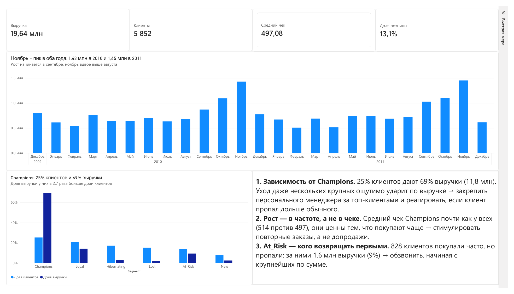
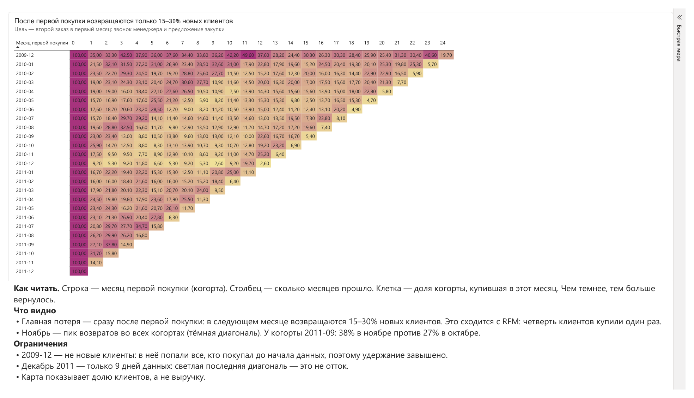

# Online Retail II: на ком держится выручка онлайн-магазина

Британский интернет-магазин подарков и товаров для дома. Данные за два года, с декабря 2009 по декабрь 2011, около миллиона строк транзакций.

По названию это обычный онлайн-магазин, но по данным видно, что работает он в основном как оптовый поставщик. 87% выручки дают зарегистрированные клиенты, которые берут товар упаковками по 12–48 штук, скорее всего для своих магазинов. Остальные 13% приходятся на розничных покупателей без аккаунта: о них магазин ничего не знает и вернуть их не может.

**Стек:** Python (pandas, matplotlib, seaborn) · SQL (SQLite) · Power BI (DAX)

## Вопросы бизнеса

1. На ком держится выручка и чем рискует магазин, если уйдут крупные клиенты?
2. Кто из ценных клиентов уже перестал покупать и сколько денег за ними стоит?
3. Возвращаются ли клиенты после первой покупки и когда мы их теряем?
4. Как выручка меняется в течение года и растёт ли бизнес?
5. Зависит ли выручка от нескольких товаров-хитов?

## Что сделано

**Python (pandas)** · [`retail.ipynb`](retail.ipynb)
- Очистка: убрал около 34 тыс. дубликатов и разобрал аномалии. Это возвраты (счета на C), бухгалтерские корректировки (на A), складские списания и служебные коды вроде POST и AMAZONFEE. Из 1,07 млн строк осталась таблица реальных продаж на 1 003 214 строк.
- Отделил опт от розницы. Сначала это была гипотеза, потом я проверил её на 4 095 товарах: 82% из них покупатели без аккаунта берут дороже, чем зарегистрированные клиенты.
- Сделал RFM-сегментацию 5 852 клиентов (6 сегментов) и когортный анализ удержания за 25 месяцев.

**SQL (SQLite)** · [`retail_sql.ipynb`](retail_sql.ipynb)
- Повторил ключевые расчёты запросами: каналы, выручка по месяцам, топ-10 товаров, RFM через CTE и `ntile`. Итоги сошлись с pandas. По расхождению в мелких сегментах увидел, что результат RFM зависит от того, как разводить клиентов с одинаковой частотой покупок.

**Power BI** · [`dashboard.pbix`](dashboard.pbix) · [PDF](dashboard.pdf)
- Две страницы. Первая — выручка и сегменты клиентов: клик по сегменту пересчитывает KPI. Вторая — тепловая карта удержания. Меры написаны на DAX, все цифры сверены с pandas.

## Главные выводы



**1. Выручка держится на четверти клиентов.** 1 476 клиентов из сегмента Champions (25%) приносят 69% выручки, это 11,8 млн. Средний чек у них почти такой же, как у всех: 514 против 497. Значит, ценны они не крупными заказами, а тем, что покупают часто. При этом самый крупный клиент в одиночку даёт 3,4% выручки. Уход даже нескольких таких оптовиков будет заметен сразу.

**2. Часть ценных клиентов уже уходит.** 828 клиентов (сегмент At_Risk) раньше покупали регулярно, но давно не возвращались. За ними 1,6 млн выручки, это 9% от выручки зарегистрированных клиентов. Это не случайные покупатели: в 2010 году они приносили стабильные деньги каждый месяц.



**3. Большинство новых клиентов теряется после первой покупки.** В следующем месяце возвращаются только 15–30% новичков, а минимум четверть всех клиентов так и не сделала второй заказ. Главная потеря происходит не со временем, а сразу, на первом шаге.

**4. Ноябрь даёт пик, а бизнес почти не растёт.** В ноябре выручка максимальная в оба года: 1,43 млн в 2010-м и 1,45 млн в 2011-м, примерно вдвое больше, чем в августе. Рост начинается в сентябре. Клиенты тоже возвращаются чаще всего в ноябре: у когорты сентября 2011 года 38% против 27% месяцем раньше. При этом январь–ноябрь 2011 года больше того же периода 2010-го всего на 3%: сезон повторяется, а роста почти нет.

**5. Хитов нет, риск в клиентах, а не в товарах.** Топ-10 товаров дают всего 8% выручки. Ассортимент широкий, и потеря любого одного товара почти не заметна. Двое из топа вообще оказались фальшивыми лидерами: каждый попал туда из-за одного гигантского заказа, который потом отменили. Поэтому рядом с выручкой товара всегда стоит смотреть число заказов.

## Рекомендации

1. **Закрепить персонального менеджера за Champions.** Ставить сигнал, если клиент не заказывает дольше своего обычного интервала: такого лучше заметить через две недели, а не через полгода.
2. **Обзвонить At_Risk, начиная с крупных.** Список из 828 клиентов отсортировать по выручке и прежде всего спросить, почему они перестали заказывать. Ответы покажут, в чём проблема: цена, ассортимент, сервис или клиент просто закрылся.
3. **Добиваться второго заказа в первый месяц.** Это самая большая потеря, поэтому новому клиенту в течение месяца после первой покупки стоит позвонить и предложить повторную закупку.
4. **Растить частоту, а не чек.** Лучшие клиенты отличаются тем, что заказывают часто, а не тем, что берут больше. Значит, напоминания о закупке и удобный повторный заказ дадут больше, чем допродажи.
5. **Готовиться к сезону с сентября.** Запасы и кампании по возврату клиентов запускать заранее, а не в ноябре, когда спрос уже на пике.
6. **Мотивировать розничных покупателей регистрироваться.** 13% выручки приносят люди, о которых магазин ничего не знает. Бонус за аккаунт сделает их клиентами, которых можно вернуть.

Всё это гипотезы, их стоит проверять на части клиентов, прежде чем внедрять на всех.

## Ограничения

- **Выручка валовая.** Возвраты и отмены (счета на C) исключены, но не вычтены, поэтому отменённые заказы остаются в выручке. Сколько магазин теряет на возвратах, я не считал.
- **Это выручка, а не прибыль.** Себестоимости в данных нет.
- **Декабрь 2011 неполный**, в нём только 9 дней. Низкий столбик на графике и светлая последняя диагональ на тепловой карте — это обрыв данных, а не отток.
- **Когорта декабря 2009 года завышена.** В неё попали все, кто покупал ещё до начала данных, поэтому это не новые клиенты.
- **Розница не входит в RFM и когорты**: у покупателей без аккаунта нет ID. Анализ клиентов покрывает 87% выручки.
- **RFM чувствителен к границам.** Баллы относительные, а у клиентов с одинаковой частотой покупок сегмент зависит от правила разведения. На Champions и At_Risk это почти не влияет, а цифры по New и Loyal ориентировочные.
- **Тепловая карта показывает долю вернувшихся клиентов, а не выручку.**

## Как запустить

**Данные:** [Online Retail II](https://archive.ics.uci.edu/dataset/502/online+retail+ii) из UCI Machine Learning Repository (лицензия CC BY 4.0), копия на [Kaggle](https://www.kaggle.com/datasets/mashlyn/online-retail-ii-uci). Архив с данными уже лежит в репозитории, скачивать ничего не нужно.

```
pip install pandas matplotlib seaborn jupyter
```

1. `retail.ipynb` — читает `online_retail_II.zip`, чистит данные и строит RFM и когорты. В конце создаёт базу `retail.db` и CSV-файлы для Power BI.
2. `retail_sql.ipynb` — запускать после первого ноутбука, он работает с `retail.db`.
3. `dashboard.pbix` — открывается в Power BI Desktop, данные уже внутри файла.

## Структура репозитория

```
├── retail.ipynb             # Python: очистка, каналы, RFM, когорты
├── retail_sql.ipynb         # SQL: те же расчёты запросами и сверка с pandas
├── dashboard.pbix           # дашборд Power BI
├── dashboard.pdf            # дашборд в PDF
├── online_retail_II.zip     # исходные данные
└── images/                  # скриншоты дашборда для README
```
